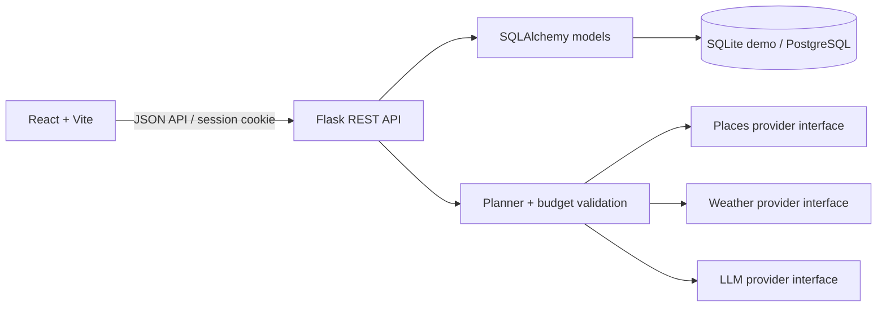
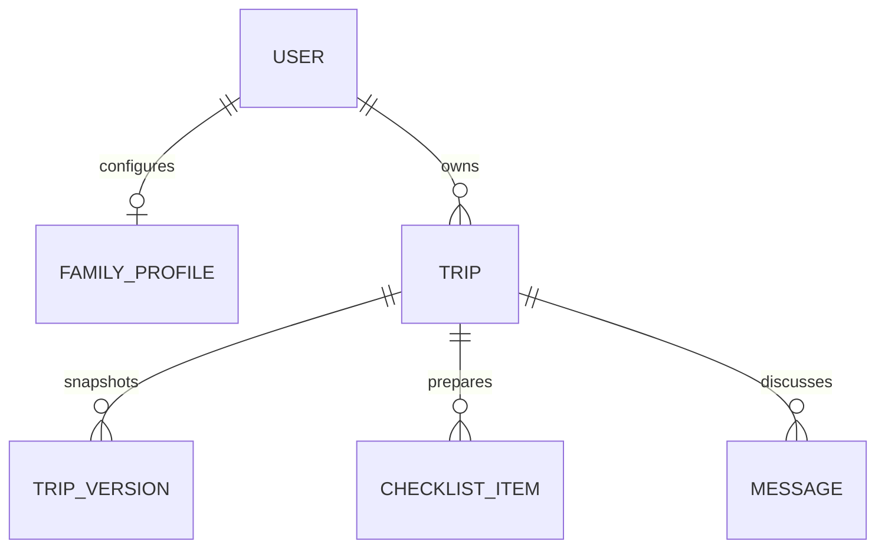

# AtlasAI
DEMO LINK:- https://atlasai-4s2j.onrender.com/ 
**Your World. Your Way.** A demo-first family travel planner with a React interface and Flask API. The included experience runs without paid API keys and marks itinerary prices and place data as estimates/demo data.

## Run locally

Requirements: Python 3.11+, Node.js 20+.

```powershell
python -m venv .venv
.venv\Scripts\Activate.ps1
pip install -r backend/requirements.txt
Copy-Item .env.example .env
python -m backend.app
```

In another terminal:

```powershell
cd frontend
npm install
npm run dev
```

Open http://localhost:5173. The API runs at http://localhost:5000. Demo data is local to the database; register an account to save trips. SQLite is the default. Set `DATABASE_URL` to a PostgreSQL URL for deployment. `SECRET_KEY` must be changed before deployment.

## Deploy a public demo to Render

The repository includes `render.yaml` and a production Gunicorn command in the Dockerfile. To deploy:

1. Push this project to a GitHub repository. Keep `.env` out of Git; `.gitignore` excludes it.
2. In Render, create a **Blueprint** and connect that GitHub repository. Render reads `render.yaml` to create the Docker web service and PostgreSQL database.
3. Wait for both services to finish deploying, then open the generated `onrender.com` address. The health endpoint is `/api/health`.
4. Create a new account and test registration, sign-in, trip planning, and saved trips.

The Blueprint selects Render's free plans for a preview. Free web services spin down after 15 idle minutes, and free PostgreSQL expires after 30 days, so those settings are not suitable for retaining real user data. Change the `plan: free` entries in `render.yaml` to paid plans before relying on the deployment; check current provider pricing first. The app creates its initial tables automatically, but it does not yet include schema migrations or production-grade account protections. Treat this deployment as a demo until those are added.

You can also run the container locally with `docker compose up --build`; the app will be at http://localhost:5000.

## Included

- Responsive AtlasAI landing/dashboard, trip creation, saved trips, itinerary view and family profile editing.
- Flask registration/login with password hashing and signed session cookies; trip endpoints enforce ownership.
- Family profile interests rank matching places, and travel pace controls the planned number of visits per day. Age ranges are stored but do not imply venue age suitability.
- SQLite/PostgreSQL-ready SQLAlchemy models, decimal-safe estimates, trip version snapshots and checklist persistence.
- Deterministic demo destination recommendations, budget-aware itinerary generation, schedule validation, budget rescue and replanning endpoints.
- Unique named demo place lists for Kerala, Hyderabad, Warangal and Bengaluru; place entry prices remain unquoted until checked with venues.
- Transport comparison links for flights, trains, buses and driving/cabs using Google Flights, MakeMyTrip, IRCTC, redBus, Google Maps and Uber. These open provider fare searches; AtlasAI does not claim live prices.
- Service interfaces for places, weather and language model providers. No live provider is enabled by default; demo records are labeled as estimates.
- Docker Compose for the app and PostgreSQL.

## API

Auth: `POST /api/auth/register`, `/login`, `/logout`; `GET /api/auth/me`.
Profile: `GET/PUT /api/family-profile`.
Trips: `GET/POST /api/trips`, `GET/PATCH/DELETE /api/trips/<id>`.
Planning: `POST /api/trips/<id>/plan`, `/validate`, `/optimize-budget`, `/replan`; `GET /api/trips/<id>/versions`, `POST /restore-version`.
Travel data: `GET /api/places/search?q=...`, `GET /api/weather?destination=...`.
Checklist and chat: `GET/PATCH /api/trips/<id>/checklist`, `GET/POST /api/trips/<id>/messages`.

## Configuration and limitations

`GOOGLE_MAPS_API_KEY` and `LLM_API_KEY` are reserved for provider adapters; this starter intentionally does not report live routes, forecasts, availability or bookings. Prices, travel durations and attraction metadata in the demo are illustrative. The built-in planner uses a deterministic heuristic (OR-Tools can be added as an optional solver); route optimization, real weather/place data, migration scripts, multilingual LLM chat, expense actuals, and production deployment hardening remain future work. Never use sample price estimates as quotes.

Family dietary and accessibility preferences can be saved in the profile, but the demo catalogue does not contain verified venue data to apply them to recommendations. Children's age ranges and adult count are stored; age suitability and per-person price calculations are not currently inferred from them.

## Architecture





